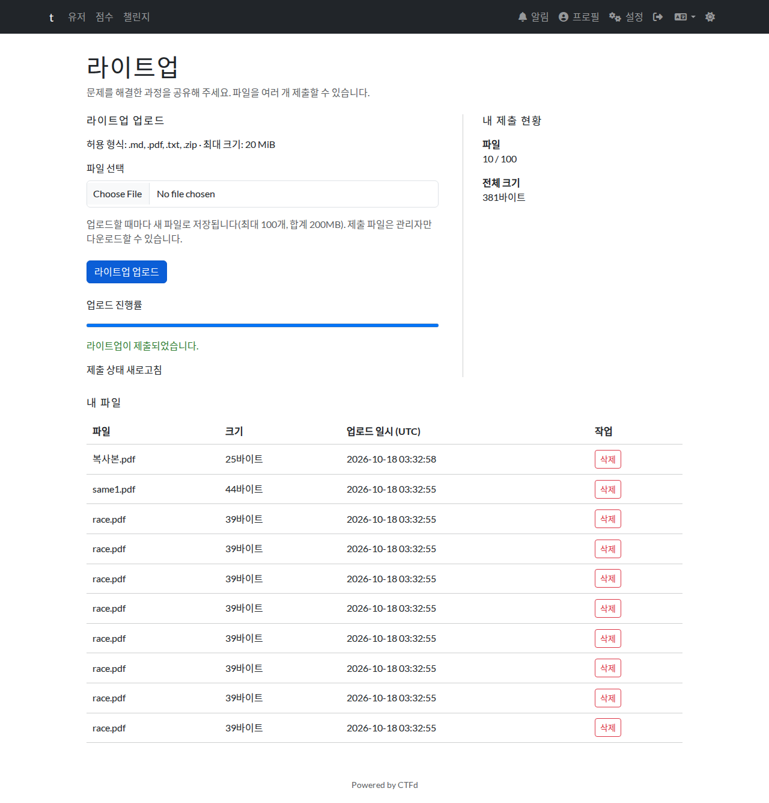
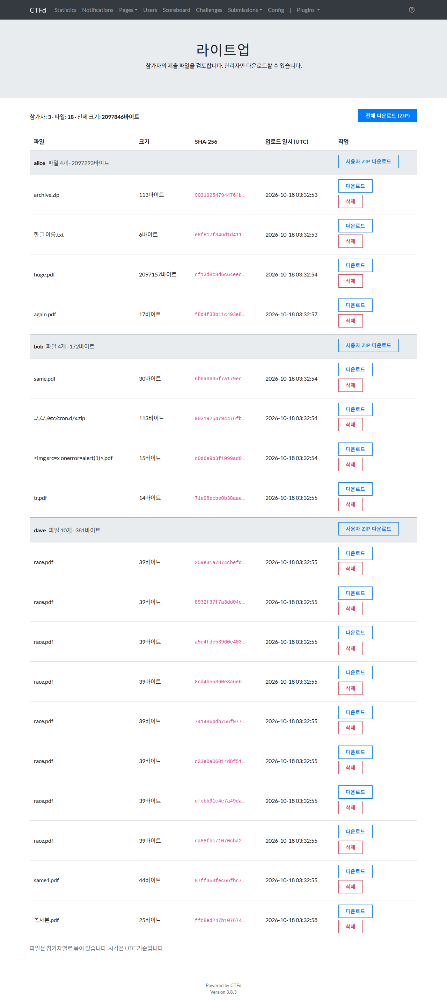

# ctfd-writeup-upload

A [CTFd](https://github.com/CTFd/CTFd) plugin that lets participants upload their **writeups as files** after a CTF,
and lets admins download them, grouped by participant.

Most existing writeup plugins store plain text or only support manual grading. This one stores real files
(`.pdf`, `.zip`, `.md`, `.txt`) and treats them as untrusted input.

| Participant (`/writeups`) | Admin (`/admin/writeups`) |
| --- | --- |
|  |  |

(Screenshots: stock CTFd 3.8.3 `core` theme, Korean locale.)

## Features

**Participants** (log in, then open `/writeups`)

- Upload up to **100 files** each: `.pdf .zip .md .txt`, max **20 MB** per file, **200 MB** in total
- Every upload is a new file (nothing is replaced). A list shows name, size and time, and the file count (`4 / 100`)
- Delete your own files. Submitting the **same content twice is rejected**, whatever the file name
- Upload progress bar
- Participants **cannot download** anything, not even their own files

**Admins** (`/admin/writeups`, also linked from the admin *Plugins* menu)

- Files grouped by participant, with file count and total size
- Download one file, **one participant's files as a ZIP**, or **everything as a ZIP** (streamed, no temporary disk)
- Delete a file

English is the source language of all messages. A Korean translation is included; add another language by putting a
catalog in `writeups/translations/<lang>/LC_MESSAGES/`.

## Requirements

- CTFd **3.8.x** (tested on the stock `ctfd/ctfd:3.8.3` image with the default `core` theme)
- **MariaDB/MySQL** recommended (the per-user limits rely on row locking). SQLite works for throw-away test installs only
- Works with any theme that extends `base.html`. The plugin does not edit themes, so add a link to `/writeups` to your
  navbar yourself

## Install

Copy the `writeups/` folder to `CTFd/plugins/writeups/` and restart CTFd. With Docker Compose, mount it read-only:

```yaml
services:
  ctfd:
    volumes:
      - ./writeups:/opt/CTFd/CTFd/plugins/writeups:ro
```

The `writeups` table is created automatically on start. Uploaded files go to `UPLOAD_FOLDER/writeups/`
(`/var/uploads/writeups/` in the official image); include that folder in your backups.

## Configuration

The limits are constants at the top of `writeups/__init__.py`:

| Constant | Default | Meaning |
| --- | --- | --- |
| `MAX_BYTES` | 20 MiB | largest single file |
| `MAX_FILES` | 100 | files per participant |
| `MAX_USER_TOTAL` | 200 MiB | total size per participant |
| `MAX_TOTAL` | 10 GiB | soft cap for all writeups |
| `MIN_FREE_BYTES` | 1 GiB | free disk space that must remain |
| `USER_LIMIT` | 30 | uploads and deletes per participant per minute |
| `ALLOWED` | `.pdf .zip .md .txt` | accepted extensions |

## Security design

- **Auth and CSRF** use CTFd's own mechanisms (`authed_only`, `admins_only`, `require_verified_emails`, the global
  CSRF nonce). Deletes are POST-only and match both the file id and its owner (someone else's id is a 404).
- **Request size is limited before CTFd parses the body.** CTFd reads form data in a global `before_request` hook, which
  parses the whole multipart body even for anonymous requests, so a size check inside the view runs too late. The plugin
  wraps the WSGI app and answers `413` / `411` first. It normalises the path the way Werkzeug does, so `//writeups`
  and `/%2Fwriteups` are covered, and it also protects direct access to gunicorn. nginx still buffers up to its own
  `client_max_body_size` for every CTFd POST, so keep that sensible.
- **File validation:** extension allow-list plus a content check (PDF signature, a real ZIP central directory, UTF-8 text
  without NUL bytes). Client file names are shown escaped and are never used as paths.
- **Storage:** random 32-hex names in `UPLOAD_FOLDER/writeups` (directory `0700`, files `0600`). Files are not
  registered in CTFd's `Files` table, so `/files/<path>` can never serve them.
- **Downloads** are admin-only, sent as `application/octet-stream` attachments with `nosniff` and a sandbox CSP.
  Download names and ZIP entry names are generated by the server (ASCII only).
- **Concurrency:** upload, limits and the duplicate check run under a per-user row lock (`SELECT ... FOR UPDATE`), so
  racing requests cannot exceed 100 files / 200 MB or store the same content twice.
- **Download-all** hard-links the files, streams the ZIP and removes the links when the response closes.
- The server **never extracts** uploaded archives. A submitted ZIP can be a zip bomb or contain path-traversal entries,
  so open downloaded files in a sandbox or VM.

## Known limits

- The total cap and the per-user rate limit are approximate (CTFd's cache get/set is not atomic).
- Deleting a user removes the database rows but leaves the files on disk. A crash between writing a file and
  committing its row can also leave one. Reconcile with the database while uploads are paused.
- Hidden or unverified users can upload when email verification is off. In team mode the limits are per account.
- The automatic `UNIQUE(user_id)` upgrade (for tables created by an early one-file-per-user version) and the row
  locking are written for MariaDB/MySQL.

## Tests

`tests/test_e2e.py` is an end-to-end test that talks to a running CTFd over HTTP. Start a **fresh, not yet set up** CTFd
with the plugin mounted, then:

```sh
pip install requests
python tests/test_e2e.py http://127.0.0.1:8000
# if your CTFd requires extra registration fields:
REG_EXTRA='{"fields[1]":"1"}' python tests/test_e2e.py http://127.0.0.1:8000
```

It covers uploads and rejections, the limits, duplicates, escaping, deletes and ownership, permissions, CSRF,
downloads and ZIPs, concurrency, the request-size guard (including `//writeups`-style aliases) and translations.
If it runs into the per-user rate limit it pauses for a minute and retries, so a full run can take a few minutes.

## Prior art and credits

The code was written from scratch. Before writing it I reviewed these existing plugins; **no code was copied or
adapted** from them:

- [lapchynski/ctfd-writeups](https://github.com/lapchynski/ctfd-writeups): text writeups; no file upload or download
- [IdanRosenzweig/ctfd_plugin_writeups](https://github.com/IdanRosenzweig/ctfd_plugin_writeups): text writeups, no admin download
- [0xc7m/ctfd-manual-verification](https://github.com/0xc7m/ctfd-manual-verification): manual grading, no file upload

The file-storage approach follows the principles of CTFd's own uploader (random directory, sanitised name).

## License

[MIT](LICENSE)

---

## 한국어 안내

CTFd에서 대회가 끝난 뒤 참가자가 **라이트업을 파일로 제출**하고 관리자가 내려받는 플러그인입니다.

- 참가자: `/writeups`에서 `.pdf .zip .md .txt` 파일을 사용자당 최대 100개(파일당 20MB, 합계 200MB) 올리고, 내 파일 목록을 보고, 내 파일을 삭제합니다. 같은 내용의 파일을 다시 올리면 거절됩니다. 참가자는 올린 파일을 내려받을 수 없습니다.
- 관리자: `/admin/writeups`에서 참가자별로 묶인 목록을 보고, 파일별·사용자별 ZIP·전체 ZIP으로 내려받고, 삭제합니다.
- 설치: `writeups/` 폴더를 `CTFd/plugins/writeups/`에 복사하고 CTFd를 재시작합니다. 테마를 수정하지 않으므로 네비게이션 바에 `/writeups` 링크는 직접 추가해야 합니다.
- 한국어 번역이 들어 있습니다(영어가 원문). MariaDB/MySQL을 권장합니다.
